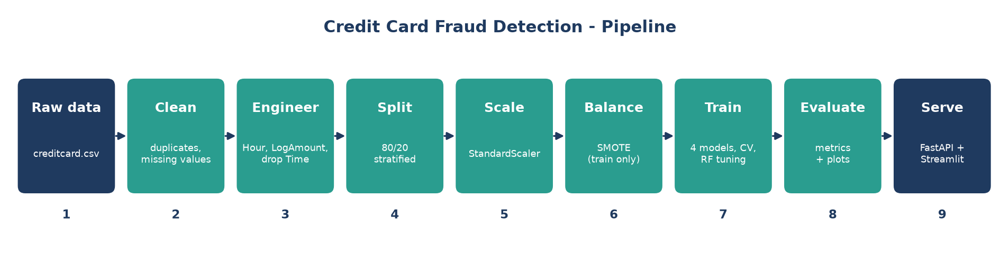

<p align="center">
  
</p>

# Credit Card Fraud Detection

An end-to-end machine learning pipeline that detects fraudulent credit card transactions. It covers data cleaning, feature engineering, class-imbalance handling with SMOTE, model comparison and tuning, evaluation, and a FastAPI service for real-time predictions.

## Features

- **Reproducible pipeline** – one command (`python main.py`) goes from raw CSV to a saved model.
- **Imbalance handling** – SMOTE oversampling on the training split only, so the test set stays realistic.
- **Model comparison** – Logistic Regression, Random Forest, XGBoost and LightGBM compared with 5-fold stratified cross-validation on F1 score.
- **Hyperparameter tuning** – `RandomizedSearchCV` over Random Forest parameters.
- **Evaluation** – accuracy, precision, recall, F1, ROC AUC, plus confusion matrix, ROC curve, precision-recall curve and feature importance plots.
- **REST API** – FastAPI endpoint that returns the prediction, fraud probability and confidence for a transaction.
- **Streamlit app** – score a single transaction or upload a CSV for batch predictions.
- **Docker and CI** – a Dockerfile for the API and a GitHub Actions workflow that runs the tests.
- **Notebooks** – step-by-step exploration from data loading to model evaluation.

## Dataset

The project uses the [Credit Card Fraud Detection](https://www.kaggle.com/mlg-ulb/creditcardfraud) dataset from Kaggle: European card transactions over two days, with 492 frauds out of 284,807 transactions (about 0.17%).

| Column | Description |
| --- | --- |
| `Time` | Seconds elapsed since the first transaction |
| `V1`–`V28` | PCA-transformed features (anonymised) |
| `Amount` | Transaction amount |
| `Class` | Target: `1` = fraud, `0` = legitimate |

The dataset is **not included** in this repository because `creditcard.csv` (~144 MB) exceeds GitHub's 100 MB file limit.

1. Download it from [Kaggle](https://www.kaggle.com/mlg-ulb/creditcardfraud).
2. Unzip it and place the file at `data/raw/creditcard.csv`.

The file is listed in `.gitignore`, so it will not be committed.

## Pipeline



```
creditcard.csv
   │
   ├─ Clean            drop duplicates, fill missing values
   ├─ Engineer         Hour = (Time // 3600) % 24, LogAmount = log1p(Amount), drop Time
   ├─ Split            80/20 stratified train/test split
   ├─ Scale            StandardScaler (fit on train only, saved to models/scaler.pkl)
   ├─ Balance          SMOTE on the training set
   ├─ Compare          4 models, 5-fold CV, F1 score
   ├─ Tune             RandomizedSearchCV on Random Forest
   ├─ Train & save     models/best_model.pkl
   └─ Evaluate         metrics + plots in reports/figures/
```

## Project Structure

```
credit-card-fraud-detection/
├── app/
│   ├── api.py                # FastAPI application
│   ├── predict.py            # Sample prediction script
│   └── streamlit_app.py      # Streamlit dashboard
├── config/
│   └── config.py             # Paths, random seed, test size, CV folds
├── data/
│   ├── raw/                  # creditcard.csv goes here (not tracked)
│   └── processed/
├── models/                   # Saved model, scaler, feature names
├── notebooks/
│   ├── 01_Data_Loading.ipynb
│   ├── 02_EDA.ipynb
│   ├── 03_Preprocessing.ipynb
│   ├── 04_Model_Training.ipynb
│   ├── 05_Anomaly_Detection.ipynb
│   └── 06_Model_Evaluation.ipynb
├── reports/
│   └── figures/              # Generated evaluation plots
├── src/
│   ├── data_loader.py        # Load the raw CSV
│   ├── preprocessing.py      # Cleaning, splitting, scaling, SMOTE
│   ├── feature_engineering.py
│   ├── train.py              # Model comparison, tuning, saving
│   ├── evaluate.py           # Metrics and plots
│   ├── predict.py            # FraudPredictor class used by the API
│   ├── anomaly_detection.py  # Placeholder
│   ├── logger.py
│   └── utils.py
├── tests/                    # pytest suite
├── .github/workflows/ci.yml  # CI: runs pytest on every push
├── Dockerfile
├── main.py                   # Runs the full training pipeline
├── requirements.txt
└── README.md
```

## Getting Started

### Prerequisites

- Python 3.10 or newer
- The dataset in `data/raw/creditcard.csv` (see [Dataset](#dataset))

### Installation

```bash
git clone https://github.com/sandipp00/credit-card-fraud-detection.git
cd credit-card-fraud-detection

python -m venv venv
# Windows
venv\Scripts\activate
# macOS / Linux
source venv/bin/activate

pip install -r requirements.txt
```

### Train the model

```bash
python main.py
```

This runs the full pipeline. It writes the model, scaler and feature names to `models/`, saves evaluation plots to `reports/figures/`, and logs progress to `logs/project.log`. Model comparison and tuning cross-validate several models on a SMOTE-balanced dataset, so expect it to take a while.

Settings such as the random seed (`42`), test size (`0.20`) and CV folds (`5`) live in `config/config.py`.

### Run the API

Train the model first, since the API loads `models/best_model.pkl` and `models/scaler.pkl` at startup.

```bash
uvicorn app.api:app --reload
```

Interactive docs are at <http://127.0.0.1:8000/docs>.

| Method | Endpoint | Description |
| --- | --- | --- |
| `GET` | `/` | API status message |
| `GET` | `/health` | Health check |
| `POST` | `/predict` | Classify a transaction |

**Example request**

```bash
curl -X POST http://127.0.0.1:8000/predict \
  -H "Content-Type: application/json" \
  -d '{
    "Time": 10000,
    "V1": -1.359807, "V2": -0.072781, "V3": 2.536346, "V4": 1.378155,
    "V5": -0.338321, "V6": 0.462388, "V7": 0.239599, "V8": 0.098698,
    "V9": 0.363787, "V10": 0.090794, "V11": -0.551600, "V12": -0.617801,
    "V13": -0.991390, "V14": -0.311169, "V15": 1.468177, "V16": -0.470401,
    "V17": 0.207971, "V18": 0.025791, "V19": 0.403993, "V20": 0.251412,
    "V21": -0.018307, "V22": 0.277838, "V23": -0.110474, "V24": 0.066928,
    "V25": 0.128539, "V26": -0.189115, "V27": 0.133558, "V28": -0.021053,
    "Amount": 149.62
  }'
```

**Example response**

```json
{
  "prediction": "Normal",
  "fraud_probability": 0.0012,
  "confidence": 0.9988
}
```

The values above are illustrative; the real output depends on your trained model.

You can also test the predictor without the server:

```bash
python -m app.predict
```

### Run the Streamlit app

Train the model first, then:

```bash
streamlit run app/streamlit_app.py
```

The app has two tabs: a form for a single transaction (with a "Load sample transaction" button) and a CSV upload that scores up to 1,000 rows and lets you download the results. The CSV needs the columns `Time`, `V1`–`V28` and `Amount`.

### Run with Docker

Train the model first so `models/` contains the saved files, then:

```bash
docker build -t fraud-detection-api .
docker run -p 8000:8000 fraud-detection-api
```

The API is then available at <http://localhost:8000/docs>. The image copies in `models/`, so rebuild it after retraining.

### Run the tests

```bash
python -m pytest tests -v
```

The tests cover cleaning, feature engineering, splitting, scaling, SMOTE and the prediction output format. They use small synthetic data and a tiny model, so they don't need the dataset or a trained model. The same command runs in GitHub Actions on every push and pull request.

## Evaluation

The final model is evaluated on the held-out 20% test split. Because fraud is so rare, accuracy is misleading, so the pipeline focuses on **precision, recall, F1 and ROC AUC**, and writes these plots to `reports/figures/`:

- `confusion_matrix.png`
- `roc_curve.png`
- `precision_recall_curve.png`
- `feature_importance.png`

Run `python main.py` to reproduce the metrics for your environment.

## Tech Stack

| Area | Tools |
| --- | --- |
| Data | pandas, NumPy, SciPy |
| Modelling | scikit-learn, XGBoost, LightGBM, imbalanced-learn |
| Visualisation | Matplotlib, Seaborn, Plotly |
| Explainability | SHAP |
| API | FastAPI, Uvicorn, Pydantic |
| Utilities | joblib, loguru, python-dotenv, tqdm |
| Testing / Quality | pytest, black, flake8 |

## Roadmap

- [ ] Anomaly detection models (`src/anomaly_detection.py`)
- [ ] API tests (the FastAPI app loads the trained model on import)
- [ ] Dashboard screenshot (`assets/dashboard.png`)

## License

No license file has been added yet. Add a `LICENSE` file (for example MIT) before others reuse this code.

## Acknowledgements

Dataset by the Machine Learning Group of ULB (Université Libre de Bruxelles) and Worldline, published on [Kaggle](https://www.kaggle.com/mlg-ulb/creditcardfraud).
